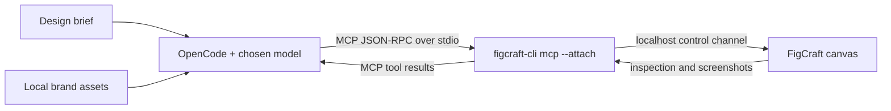

# 🎨 FigCraft × OpenCode MCP Engine

> **Prompt-to-canvas design pipeline:** Use OpenCode and a supported reasoning model to create editable UI layouts, social posts, menus, and other designs in a running FigCraft canvas through Model Context Protocol (MCP).

This repository publishes **documentation and configuration templates**, not a fork of FigCraft or a standalone MCP server. [FigCraft](https://github.com/storytold/figcraft) provides the CLI, MCP server, and native canvas command engine. OpenCode orchestrates design tasks with your chosen model (for example, a configured DeepSeek or GPT model).

Read [the origin story](docs/STORY.md), [the architecture](templates/Architecture.md), and [the full setup and prompt guide](templates/FigcraftoOpenCodemcp.md).

## What you can build

- Social posts and carousels with editable 1080 × 1080 or 1080 × 1350 frames.
- Menus, flyers, and website hero sections with structured typography and layout.
- Designs with local brand logos, SVGs, and images placed into native FigCraft nodes.
- Auto-layout frames and reusable elements that you can inspect and refine in the app.

Results depend on the model, prompt, installed tools, and your review; this is not a guaranteed one-shot design generator. Model/API access and web assets may incur costs or require separate licenses.

## Architecture



OpenCode starts the local MCP server as a child process. The server connects to a **separately running** FigCraft app on the same control port. The app's control channel is loopback-only. See [Architecture.md](templates/Architecture.md) for the protocol and headless alternative.

## Quickstart

Prerequisites: [OpenCode](https://opencode.ai/v2/docs/), Rust/Cargo to build FigCraft (or a FigCraft release that includes the CLI), Git, and a model available to your OpenCode installation.

1. From this repository's parent directory, build FigCraft's CLI and app:

   ```sh
   git clone https://github.com/storytold/figcraft.git
   cd figcraft
   cargo build --release -p figcraft-cli -p figcraft
   ```

2. In **this repository** (the OpenCode workspace), create `branding_assets/` and `downloads/`. Copy [`.mcp.json.template`](.mcp.json.template) to `opencode.json`. The template points to a sibling `../figcraft/target/release/figcraft-cli`; adjust the relative path if you built FigCraft elsewhere. OpenCode V2 reads `opencode.json(c)` or `.opencode/opencode.json(c)`, **not** `.mcp.json`. Set the same port for the app and MCP config:

   ```sh
   mkdir -p branding_assets downloads
   cp .mcp.json.template opencode.json
   export FIGCRAFT_PORT=7979
   ../figcraft/target/release/figcraft --control "${FIGCRAFT_PORT}"
   ```

   Leave the FigCraft app running. From another terminal in this workspace, export `FIGCRAFT_PORT=7979`, then run `opencode mcp list` to check the connection and launch `opencode`. For exact commands and alternate installations, follow [the setup guide](templates/FigcraftoOpenCodemcp.md).

3. In OpenCode, try:

   > Check `./branding_assets/` for a logo. Design a dark-mode 1080 × 1080 product announcement with a headline, supporting text, and CTA. Use FigCraft MCP tools; inspect the layer tree and screenshot before finishing.

## Repository layout

```text
.
├── .mcp.json.template             # Portable OpenCode V2 MCP configuration (copy to opencode.json)
├── README.md                      # Overview and quickstart
├── LICENSE                        # MIT license for this repository
├── docs/STORY.md                  # Origin story
├── templates/Architecture.md      # Protocol and component architecture
└── templates/FigcraftoOpenCodemcp.md # Full setup and prompt templates
```

## License

This repository is [MIT licensed](LICENSE). FigCraft and any third-party assets retain their own licenses; this project is not affiliated with the FigCraft maintainers.
